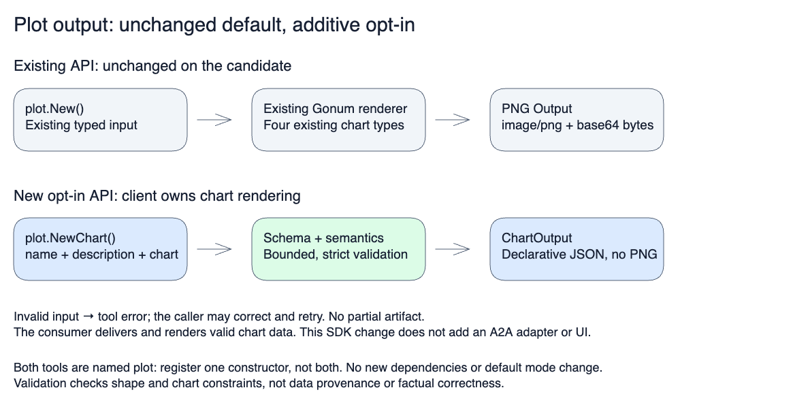

# Plot tool

## Existing PNG output (unchanged)

```go
registry.Register(plot.New())
```

`New()` and the exported `Tool`, `Input`, and `Output` types keep their existing
contract: `chart_type` plus `line_data`, `bar_data`, `scatter_data`, or
`histogram_data` produces base64 PNG bytes with `mime_type: image/png`.
This remains the default. No global mode or shared configuration changes it.

## Opt-in interactive chart data

```go
registry.Register(plot.NewChart())
```

Register **one constructor, not both**: both tools are named `plot`.
`NewChart()` accepts `ChartInput`: `name`, `description`, and a declarative
`chart` object. Its schema describes 28 chart types. All chart-specific fields
belong inside `chart.data`.

```json
{"name":"Requests","description":"Supplied regional counts","chart":{"type":"bar","data":{"labels":["US","EU"],"datasets":[{"label":"Requests","data":[120,80]}]}}}
```

The result is `ChartOutput`, with a unique artifact ID, the original chart data,
and `mime_type: application/vnd.redpanda.chart+json`. It contains no generated
HTML, JavaScript, or PNG. The consumer must deliver the result as an artifact
and validate/render it using its chart renderer. The tool itself does not write
A2A events or render charts. Do not ask the model to rewrite the result as Markdown.

Malformed/ambiguous JSON, unknown fields, invalid relationships, non-finite ranges,
and oversized inputs return an error. The registry surfaces execution errors to
the model so it can correct the request. Limits include 100,000-byte input and encoded output, 2,000 tabular
cells or XY points, 500 hierarchy nodes or timeline intervals, and 100 Sankey nodes/1,000 links, and 100 node-link nodes/500 links.
The encoded output cap fits the default registry's 25,000 estimated-token budget, including artifact metadata and JSON escaping. Oversize charts return an actionable tool error, not a successful `response_too_large` note. A consumer configuring a smaller registry response budget must raise it for this tool or enforce its own tighter admission limit; the registry remains unchanged.

Optional members accept omission or `null`, including the chart title, gauge
label, hierarchy root parent, and internal-node value. The tool removes these
absent object members from its output. Array `null` observations, numeric labels,
and supplied numeric values are preserved. Required or unknown members with
`null` still fail validation. This supports strict tool calls from the SDK's
OpenAI Responses and OpenAI-compatible Chat request mappers; local mapper tests
are not evidence of live provider acceptance.

The schema's descriptions include chart-specific rules and aggregate limits.
Validation selects the declared chart type so errors identify missing fields
(for example, a gauge's `min`) rather than an unrelated union branch.
All-zero or all-null composition data remains valid: the SDK returns the supplied
values, not percentages. Consumers must show an empty state or guard a zero
total when normalizing for display; missing observations must not become zeros.

Validation checks shape and mathematical constraints, **not data provenance or
truth**. The agent still needs source-grounded values and must not invent missing
bounds, quantiles, or flows. This API does not guarantee factual correctness.

## Output flow



[Editable diagram](../../../docs/diagrams/plot-output.excalidraw).
Source: `New`/`Tool.Execute` in `tool.go`, `NewChart` in `chart.go`, and
`chart_validation.go`. `chart_test.go` exercises both public APIs.

## Timeline / Gantt

Use `type: "timeline"` for observed task intervals, including parallel tools.
Every `start` and `end` is a numeric elapsed offset from the same origin, in
the explicit `unit`. Calendar-date parsing and trace collection are not included.

```json
{"name":"Agent execution","description":"Synthetic example, not a live trace","chart":{"type":"timeline","data":{"unit":"ms","intervals":[{"label":"Search","start":120,"end":640},{"label":"Read metrics","start":120,"end":410},{"label":"Done","start":640,"end":640}]}}}
```

Up to 500 intervals retain their supplied order, including overlaps and repeated
labels. Require nonblank labels/units, finite offsets, `start <= end`, and a finite
overall range. Equal endpoints represent an instantaneous event, not a fabricated
duration. Missing/unfinished end times must be requested, not guessed. Consumers
should show separate rows on a shared axis, render instantaneous events visibly,
and retain full labels and exact offsets in their data view.

### Waterfall, ECDF and node-link charts

- `waterfall`: `data: {unit, steps: [{label, kind: "total" | "delta", value}]}`. First step is an explicit starting total. Deltas update it; later totals must reconcile within `1e-9 * max(1, abs(expected), abs(supplied))`. Totals are not counted twice. At most 500 steps. Consumers draw cumulative intervals; zero changes remain visible. Never invent the starting balance or missing contributions.
- `ecdf`: `data: {unit, datasets: [{label, data: [number, ...]}]}`. Supply actual samples, not averages or precomputed percentile summaries. At most 20 datasets and 2,000 observations across them. Consumers sort and draw a staircase for `count(samples <= x) / sample size`, grouping ties; no smoothing or fabricated samples. Each series has its own denominator. Returned sample order and values are unchanged.
- `nodeLink`: `data: {nodes: [{id, label}], links: [{source, target}]}`. Directed, unweighted relationships. Cycles and isolated nodes are supported; IDs must be unique and every endpoint must exist. At most 100 nodes and 500 links. Repeated directed edges and self-links are rejected. Position and distance have no metric meaning; use Sankey for quantitative flows.

These are optional structured-output capabilities. `New()` still returns PNGs using the existing line, bar, scatter and histogram implementation. No renderer, network call, trace collection or factual-provenance guarantee is added to the SDK.

## Targets, stages and distribution comparisons

- `bullet`: `data: {unit, min, max, measures: [{label, value, target}]}`. Up to 100 measures share an explicit finite domain (`min < max`). Actual values and supplied targets must lie inside it. Render actual bars and target ticks on that same scale; do not invent targets.
- `funnel`: `data: {cohort, stages: [{label, count}]}`. Up to 100 ordered stages from the same named cohort. Counts are nonnegative safe integers and never increase. Retain zero counts. A percentage of a zero initial count is undefined, not zero percent. The tool validates counts, not whether the stated cohort is genuine.
- `violin` and `ridgeline`: `data: {unit, thresholds: [number, ...], datasets: [{label, data: [number, ...]}]}`. Explicit common bin edges (2–101, strictly increasing); at most 20 series and 2,000 actual samples. Samples must fall inside the edge domain. Bins are left-inclusive/right-exclusive except the final right edge, which is included. Consumer profiles use `count / (sample size × bin width)`, normalized against the same peak density across all series. These are histogram density profiles, not smoothed kernel estimates. Keep the original samples in Code and expose counts, sample sizes and density in Data. Do not draw sample-size comparisons from profile width.

```json
{"name":"Targets","description":"Synthetic example, not live telemetry","chart":{"type":"bullet","data":{"unit":"ms","min":0,"max":1000,"measures":[{"label":"Search","value":250,"target":500}]}}}
```

## Uncertainty and small multiples (existing chart types)

Line and scatter datasets may include `bounds: {label, lower: [number|null, ...], upper: [number|null, ...]}`. The nonblank label describes what the interval means, for example measured min/max. Lower/upper arrays match the observation count; each interval contains its central value. Missing line observations require two null bounds. Ranges must remain finite within and across series. Other chart types reject bounds. Consumers draw linear bands/boundaries for line charts and vertical error bars for scatter charts. No confidence intervals or observations are inferred by this API.

Existing `bar`, `line` and `scatter` charts may request top-level `layout: "smallMultiples"` and a required `data.unit`. Up to 12 series render as separate panels of the same chart, with common positional domains and categorical order. This is a layout capability, not another chart family. The supplied JSON stays unchanged; consumer layout never creates new source values. Without these options, previous chart behavior is retained.
